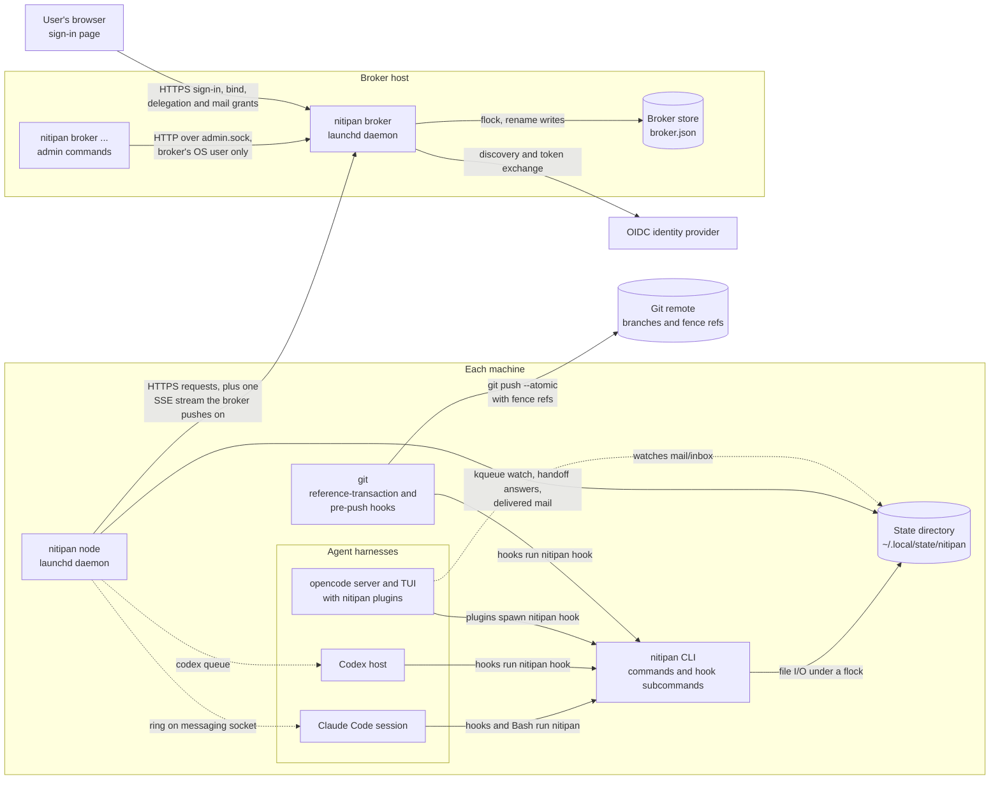
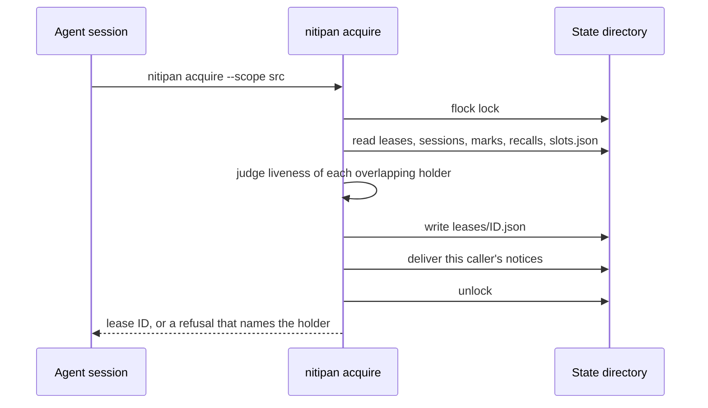
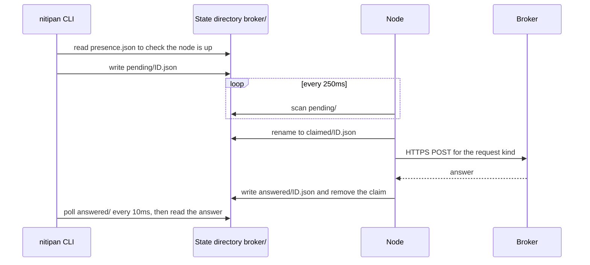
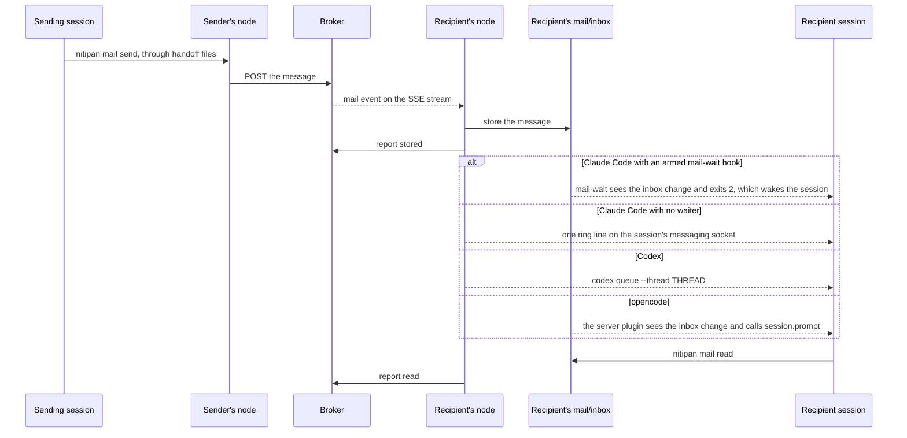
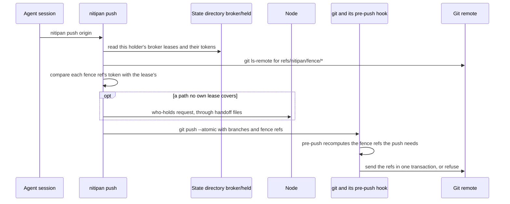

# Architecture

nitipan is one binary with three roles. As a CLI, it runs inside agent sessions, agent hooks, and git hooks. As a
node, it runs as a daemon on each machine that uses a broker. As a broker, it runs as a daemon on one host. On a
single machine, only the CLI role is needed.

The state directory, `~/.local/state/nitipan/`, is the meeting point on each machine. The CLI reads and writes it
directly. The node watches it and mirrors it to the broker. No component on a machine listens on a network port.

## Overview

Solid arrows are calls that the source starts. Dotted arrows are signals that only say something is waiting. Each
connection between a machine and the broker host starts on the machine. The broker never connects in, as
[ADR-01](../spec/adrs/ADR-01-machines-connect-out-to-broker.md) records.

## Coordination, not correctness

Git guarantees the repo's data. It rejects a non-fast-forward push. An atomic push applies all its refs or none. The
broker, the leases, and the fence refs sit on top of that as coordination layers. The broker orders grants across
machines. A lease says which session should work in a domain, and it expires when its holder goes quiet. A fence makes
the remote enforce that lease against a holder that lost it without knowing. Each layer makes collisions between agents
rarer. None of them guards against data loss.

A run with no broker has no fencing at all, and that is a supported setup. Sessions on different machines then meet only
at git's fast-forward rule. A lease check in place of fencing is graceful degradation. It is strictly better than the
no-broker baseline. A gap in fencing weakens coordination. It is never a correctness defect.

The fence exists so the remote enforces the lease and the holder never needs the broker at push time. A change to the
push path is weighed against that purpose. A change that puts the broker in every fenced push defeats the fence. See
[ADR-09](../spec/adrs/ADR-09-fencing-is-coordination-not-correctness.md).

## Honoring the user's configuration

nitipan honors its user's configuration in every scope git reads. A value the user sets is the user's decision. nitipan
never ignores it, overrides it, or treats it as an accident to guard against.

nitipan does not offer an unsafe value. Every value it does offer is legitimate, and setting it needs no justification.
A warning about a legitimate value is short and non-intrusive, such as one stderr line that says what the value does.
The `nitipan.<remote>.fence` key follows this rule. See [Pushing](reference/pushing.md#fence-modes).

## Components

| Component | Runs as | Talks to |
|-----------|---------|----------|
| CLI | the agent session's user, inside the agent's sandbox | the state directory, and the node through handoff files |
| Agent hooks and plugins | the agent's host process | the CLI, through `nitipan hook ...` with JSON on stdin |
| git hooks | git, in any checkout with `setup git --install` | the CLI, through `nitipan hook reference-transaction` and `nitipan hook pre-push` |
| Node | a LaunchAgent, `dev.nitipan.node`, one per user per machine | the state directory, the broker, and idle sessions |
| Broker | a LaunchAgent on the broker host, as an OS user no agent runs as | its store, its admin socket, nodes, browsers, and the identity provider |

The node reads its config from `~/.config/nitipan/node.json`, and the broker from `~/.config/nitipan/broker.json`.
Neither file is in the state directory. A sandboxed agent can write the state directory, so nothing the node executes
or trusts lives there. [ADR-07](../spec/adrs/ADR-07-node-runs-only-input-sandboxes-cannot-write.md) records that
rule.

## Local claims

A claim on one machine never leaves it. The CLI takes the state lock, reads the records that could overlap, judges
each holder's liveness, and writes the new lease. No daemon is involved.

A Claude Code holder is alive while its process runs. Codex and opencode holders are judged by session. The Codex
SessionStart and SessionEnd hooks write `sessions/registered/` and `sessions/ended/`. The opencode plugins write
`sessions/presence/` and `sessions/executing/`. See [Leases](reference/leases.md).

## Broker requests

A command that needs the broker, such as `acquire --reach user`, `who holds`, `renew`, or `mail send`, never opens a
network connection. It hands the request to the node through files in the state directory.

If the node does not claim the request before the deadline, the CLI withdraws it. The error then says the node is not
running and prints how to install it. The CLI's sandbox needs only the state directory, never the network.

## The node and the broker

The node keeps the broker's view of this machine current:

- It watches `leases/`, `mail/reg/`, and `recalls/` with kqueue. After a change, and after each heartbeat, it posts a
  full snapshot of the machine's leases and mailboxes.
- It renews the broker leases it holds for this machine's sessions before their term runs out.
- It holds one long-lived `GET /v1/stream`. The broker pushes lease changes, refused-claim notices, mail, mail stages,
  and bounces on that stream as server-sent events. The node acks each one.

The broker stores its state in one JSON file and holds a flock on it for its lifetime. A second broker on the same
store refuses to start. The sign-in pages share the broker's TCP listener. They exist only when the broker config has
an `oidc` block. The admin commands reach the broker over `admin.sock`, which accepts only the broker's own OS user.
See [Running the broker](operations/broker.md) and [Running nodes](operations/nodes.md).

## Mail and wake paths

Mail travels from the sender's node to the broker, and then down the recipient node's stream. The recipient node
stores it in `mail/inbox/`. Then each harness is woken its own way. A wake only says mail is waiting. Only
`nitipan mail read` consumes it, as [ADR-06](../spec/adrs/ADR-06-wake-paths-signal-and-only-a-read-consumes.md)
records.

The same wake paths also ring for a notice that a locked nitipan call would deliver, and for a pending request on a
lease the session holds. Those rings say to run `nitipan list`. See [Mail](reference/mail.md).

## Git hooks and pushes

The `reference-transaction` hook runs for every ref update that touches a branch or HEAD. It runs
`nitipan hook reference-transaction prepared`, which reads the state directory without the lock. It never asks the
node, so commits stay local and fast.

`nitipan push` and the `pre-push` hook do reach out. They read the fence refs on the remote with `git ls-remote`. For
a path that the caller's broker leases do not cover, they ask the broker through the node. `nitipan push` then runs one
`git push --atomic` with the branches and the fence refs together.

A host can refuse `--atomic` or a fence ref. Unless the remote's `nitipan.<remote>.fence` key says otherwise, that one
push then gets a lease check in place of fencing, with a short warning. `nitipan push` sets `NITIPAN_FENCE_FALLBACK` on
the fallback git call, so the `pre-push` hook accepts the fence-less push and runs its own lease check on it. The pusher
decides this from the output of `git push --porcelain`. See [Fence modes](reference/pushing.md#fence-modes).

The node records each broker lease it holds, with its fencing token, under `broker/held/` in the state directory.
`nitipan push` reads those records directly. It asks the broker only about paths its own leases do not cover. When a
fence ref holds a higher token, the push is refused, and the CLI reports that token to the broker through the node.

See [Git hooks and fence marks](reference/git-hooks.md) and [Pushing under a broker lease](reference/pushing.md).
